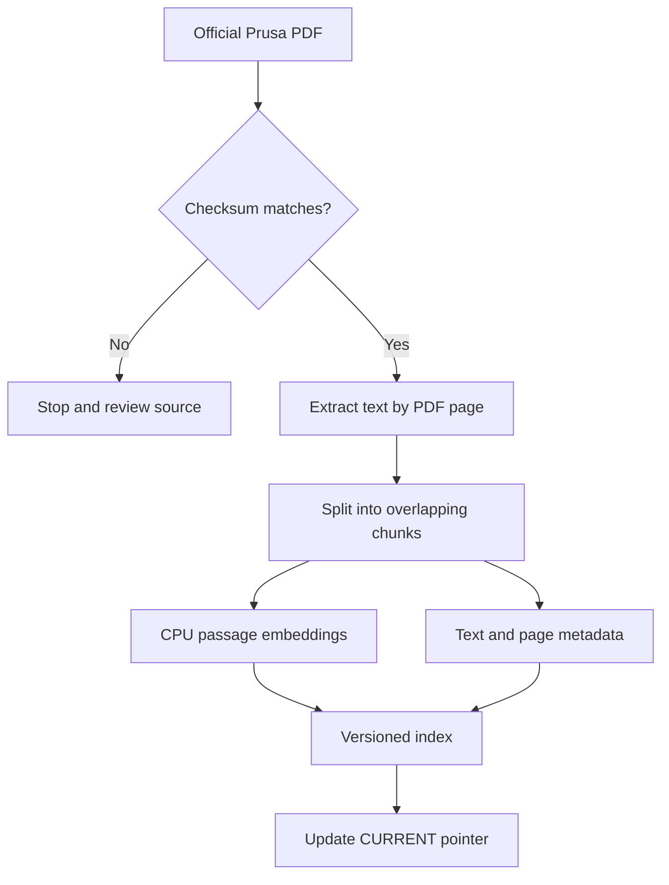
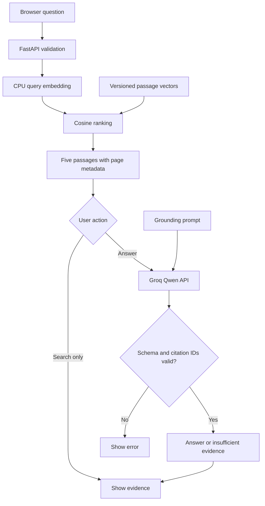
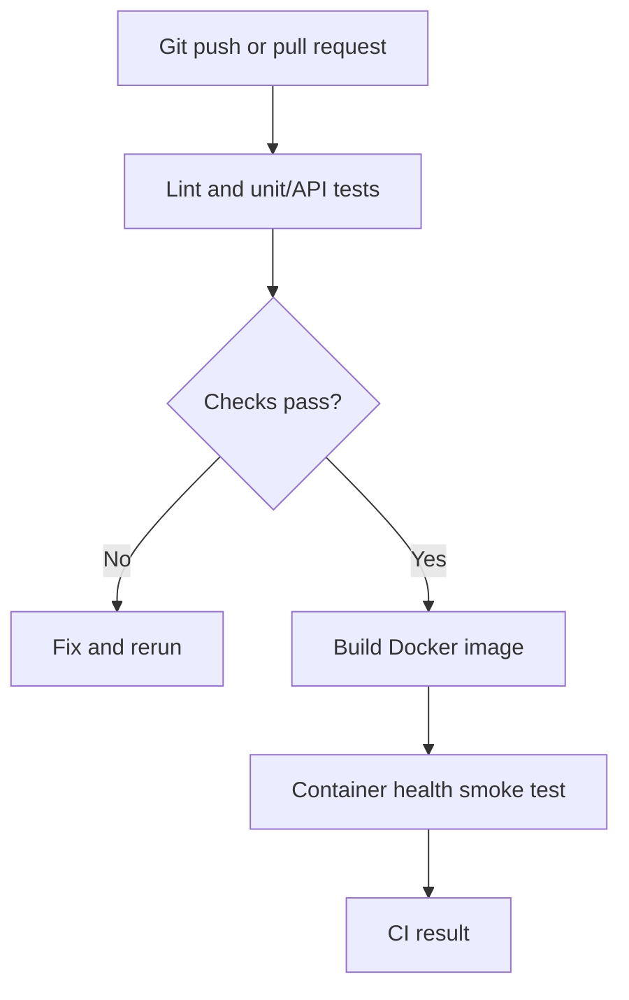

# How this application works

## Build the searchable corpus once

`download` verifies a specific manual version. `index` extracts text without OCR and splits each page independently. Each chunk is at most 1,000 characters with approximately 160 characters of overlap; word boundaries adjust the actual sizes. Page boundaries never merge. This is a simple character-based splitter, not a semantic or token-aware splitter. The embedding model has a token limit; evaluate long/dense text before adding different manuals.

FastEmbed runs BGE-small on the CPU. It produces 384 numbers for each passage. Vectors are normalized to length one, so their dot product is cosine similarity. The index stores text in JSON and vectors in NPY; it is not a vector database service.

The manifest records source/version, model name, chunk settings and hashes. A version is derived from those values and artifact contents. Each rebuild creates or reuses a version folder, then atomically switches a small CURRENT pointer. The API loads the selected version at startup; restart after rebuilding. Keep old folders to support local rollback. Do not run two index builds simultaneously.

Model weights are cached; upstream model artifacts and container tags are not pinned to immutable digests in this implementation. File hashes identify generated index artifacts, not a complete reproducible model supply chain. A production release should pin model revisions and image digests as well.

## Answer one question

BGE uses the model's passage/query embedding methods. Retrieval ranks all chunks and takes five, allowing at most two from one page. No similarity threshold is configured; a top-ranked passage can still be irrelevant. The LLM receives the question plus these passages and instructions to answer only from them. It can refuse when evidence is insufficient.

The LLM returns JSON containing a status and a list of statements. Each statement has text and a nonempty list of source IDs. Pydantic checks that structure; citation validation rejects IDs absent from the retrieved passages. Python renders the visible citation markers and derives the final citation list, so the model does not need to synchronize two representations. Refusals carry no statements and use an application-owned message. That does **not** establish that every claim is supported, that the answer is complete, or that the model reliably resists prompt injection. Human review and an answer evaluation set are needed. There is no fine-tuning or gradient update.

The UI renders returned text as text, not raw model HTML. It shows the retrieved evidence so you can compare the answer to the original PDF. No chat history is forwarded; each question is independent.

## What changes where?

| Change | Edit | What to rerun |
|---|---|---|
| Question wording | Browser | Ask again |
| Answer instructions | `prompts/answer.txt` | Restart API, rerun answer evaluation |
| Hosted model | `.env` LLM_MODEL | Restart API, verify provider compatibility and answer quality |
| Retrieval count | `.env` TOP_K | Restart API, rerun retrieval and answer evaluation |
| Embedding model | `handbook/config.py` model and dimension | Rebuild index; restart; evaluate |
| Chunk size/overlap | `handbook/config.py` | Rebuild index; restart; evaluate |
| Source PDF | `sources/prusa-mk4s.json` plus product prompt/UI/evaluation | Review parsing, download, rebuild, restart, evaluate |
| Infrastructure | Optional hosting configuration | Review the plan, deploy and smoke-test |

## Delivery flow

Tests do not download the manual or embedding model and do not contact Groq. They test contracts and failure handling with stubs. Run `evaluate` separately against the real corpus for retrieval checks. A future deployment process should include reviewed live answer evaluation. A green unit test run alone is not proof of good RAG answers.

`/health` reports the web process is alive. `/ready` reports the retrieval index/model loaded and whether a key is configured; it does not test Groq connectivity, quota or key validity. Request logs include ID, status, elapsed time and index version, not question text or secrets. Token counts come from the provider response.

The API limits answer generation to one concurrent request per process. This bounds local resource usage; it is not distributed abuse protection. Deployment requires authentication, proper request limits, HTTPS, secrets management and budget controls.
